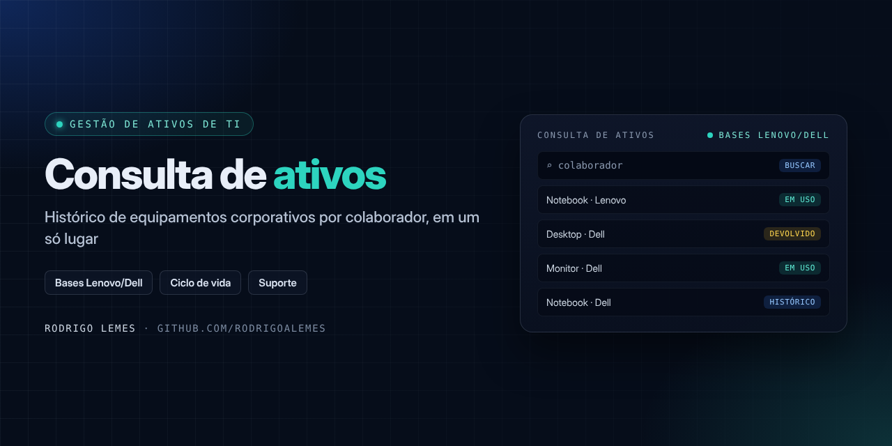
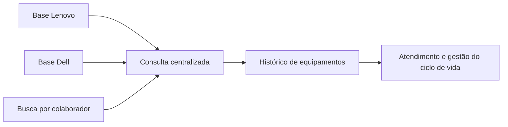

<p align="center">

</p>

<h1 align="center">Consulta de Ativos de TI</h1>
<p align="center"><i>Histórico de equipamentos corporativos por colaborador, em um só lugar</i></p>

<p align="center">


</p>

## Sumário

- [Sobre](#sobre)
- [Problema e solução](#problema-e-solução)
- [Funcionalidades](#funcionalidades)
- [Como funciona](#como-funciona)
- [Tecnologias](#tecnologias)
- [Benefícios](#benefícios)
- [Estrutura do repositório](#estrutura-do-repositório)
- [Autor](#autor)

## Sobre

Ferramenta para **consulta rápida ao histórico de equipamentos corporativos**, reunindo as bases **Lenovo** e **Dell**. Agiliza o atendimento e a recuperação de informações de ativos por colaborador, apoiando a **gestão do ciclo de vida dos ativos de TI**.

> [!NOTE]
> Projeto desenvolvido em ambiente corporativo. O código-fonte e os dados não são publicados por conterem informações internas; este repositório documenta o problema, a solução e o funcionamento.

## Problema e solução

| | |
| --- | --- |
| **Problema** | As informações de equipamentos ficavam espalhadas em bases diferentes, e encontrar o histórico de um colaborador tomava tempo do atendimento. |
| **Solução** | Uma consulta centralizada: informa-se o colaborador e a ferramenta retorna os equipamentos associados a ele nas bases Lenovo e Dell. |

## Funcionalidades

- Consulta centralizada por colaborador
- Reúne as bases de equipamentos Lenovo e Dell
- Histórico dos equipamentos associados a cada pessoa
- Apoio ao atendimento e ao ciclo de vida dos ativos

## Como funciona



Detalhes: [Como funciona](docs/como-funciona.md)

## Tecnologias

| Tecnologia | Uso no projeto |
| --- | --- |
| Bases Lenovo/Dell | Fonte do histórico de equipamentos |
| Consulta centralizada | Busca única por colaborador |

## Benefícios

- Menos tempo de pesquisa no atendimento
- Informação de ativos centralizada
- Apoio à gestão do ciclo de vida dos equipamentos

## Estrutura do repositório

```text
consulta-ativos-ti/
├── assets/
│   └── capa.png
├── docs/
│   └── como-funciona.md
└── README.md
```

## Autor

**Rodrigo Lemes** · Analista de TI · Microsoft 365, AD/Entra ID, Automação, Power BI e IA aplicada

[](https://www.linkedin.com/in/rodrigoalemes/)
[](https://github.com/rodrigoalemes)
